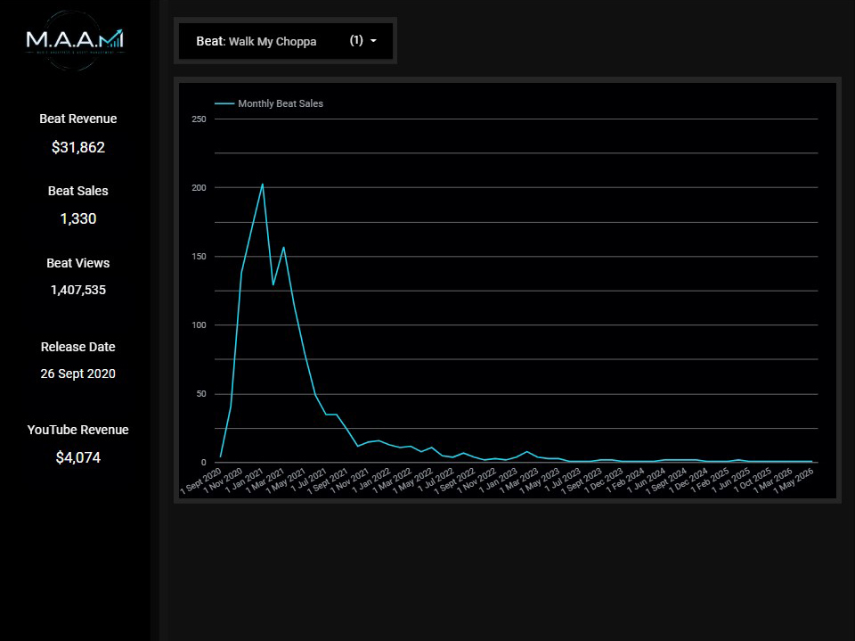

# MAAM

<p align="center">
  
</p>

<p align="center">
<strong>Music Analytics & Asset Management</strong><br>
An end-to-end data engineering platform that unifies YouTube Analytics and BeatStars sales into a single business intelligence solution.
</p>

---

# Overview

MAAM (Music Analytics & Asset Management) is an end-to-end data engineering project built to automate the collection, transformation, modeling and visualization of music business data.

The platform combines data from YouTube Analytics and BeatStars into a unified analytical model, allowing music producers to monitor performance, evaluate individual beats and make better business decisions from a single dashboard.

Rather than focusing only on visualization, MAAM emphasizes real-world data engineering concepts including ETL pipelines, dimensional modeling, data quality, cloud orchestration, business rules and cross-platform entity matching.

---

# Dashboard

## Overview

<p align="center">

</p>

The Overview dashboard provides a complete snapshot of the music business.

Features include:

- BeatStars Revenue
- YouTube Revenue
- Total Sales
- Total Views
- Geographic audience distribution
- Best selling beats
- Revenue vs Views analysis

---

## Beat Performance

<p align="center">

</p>

Analyze the lifetime performance of an individual beat across platforms.

Features include:

- BeatStars Revenue
- YouTube Revenue
- Beat Sales
- Beat Views
- Release Date
- Historical monthly sales

---

# Features

- Automated ETL pipelines
- YouTube Data API integration
- YouTube Analytics API integration
- BeatStars sales ingestion
- Bronze / Silver / Gold architecture
- BigQuery dimensional data warehouse
- Star schema modeling
- Historical BeatStars sales tracking
- Cross-platform beat matching
- Manual business rules for edge cases
- Country-level audience analytics
- Cloud Run Jobs
- Cloud Scheduler automation
- Secret Manager integration
- Interactive Google Data Studio dashboard

---

# Architecture

```
             YouTube Data API
                    │
                    │
        YouTube Analytics API
                    │
                    │
        BeatStars Sales Export
                    │
                    ▼
          Python ETL Pipeline
     Extract → Transform → Validate
                    │
                    ▼
          Local Silver Parquet
                    │
                    ▼
              Google BigQuery
        ┌────────────┴────────────┐
        │                         │
        ▼                         ▼
     Silver Layer             Gold Layer
        │                         │
        └────────────┬────────────┘
                     ▼
          Cloud Run Scheduled Jobs
                     │
                     ▼
          Google Data Studio Dashboard
```

---

# Data Model

## Silver Layer

- dim_youtube_video
- fact_youtube_video_metrics
- sales_summary

---

## Gold Layer

- dashboard_overview
- youtube_video_performance
- youtube_country_performance
- beatstars_sales_performance
- beatstars_daily_beat_sales
- beatstars_monthly_beat_sales
- cross_platform_beat_performance
- beatstars_matching_rules
- dim_beat

---

# Engineering Challenges

## Cross-platform Entity Matching

BeatStars products and YouTube videos do not share a common identifier.

MAAM resolves this by combining normalized beat names, deterministic business rules and manual overrides where required.

---

## Ambiguous Product Names

Different BeatStars products may legitimately share the same product name.

Instead of creating incorrect joins, ambiguous matches are isolated until deterministic matching rules become available.

---

## Manual Matching Rules

Historical edge cases are handled through a dedicated matching table instead of hardcoded SQL logic.

This approach keeps transformation logic clean while allowing controlled business overrides.

---

# Technologies

- Python
- Pandas
- Google BigQuery
- Google Cloud Run Jobs
- Google Cloud Scheduler
- Google Secret Manager
- YouTube Data API
- YouTube Analytics API
- Google Data Studio
- Git
- GitHub

---

# Project Structure

```
src/
│
├── extract/
├── transform/
├── load/
│
main.py
README.md
```

---

# Requirements

This project uses private YouTube Analytics data, private BeatStars sales exports and a personal Google Cloud project.

To run the pipeline yourself you will need:

- Google Cloud Project
- OAuth Credentials
- YouTube Data API
- YouTube Analytics API
- BeatStars Sales Export
- BigQuery Dataset

---

# Running the Pipeline

Activate the virtual environment

```powershell
.\.venv\Scripts\Activate.ps1
```

Run the complete ETL pipeline

```powershell
python main.py
```

---

## Roadmap

### Version 4 (Planned)

- Dynamic Time Intelligence
  - Last 24 Hours
  - Last 7 Days
  - Last 30 Days
  - Last 90 Days
  - Lifetime

- Estimated Exclusive Value
  - Data-driven exclusive pricing based on historical performance

---

Future versions may include additional platform integrations, advanced business intelligence features and AI-assisted analytics.

# Current Version

**MAAM v3.0**