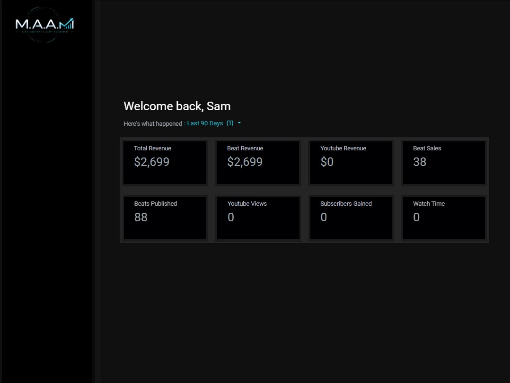
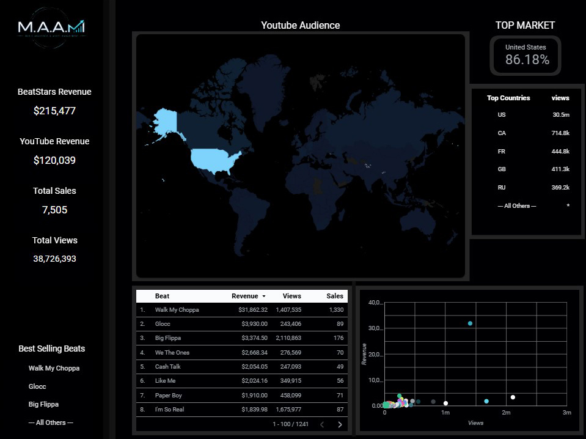

# MAAM

<p align="center">
  
</p>

---

# Overview

MAAM (Music Analytics & Asset Management) is an end-to-end data engineering and business intelligence project built to automate the collection, transformation, modeling and visualization of music business data.

The platform combines data from YouTube Analytics and BeatStars into a unified analytical model, allowing music producers to monitor business performance, evaluate individual beats, analyze historical trends and make data-driven pricing decisions from a single dashboard.

Rather than focusing only on visualization, MAAM emphasizes real-world data engineering concepts including ETL pipelines, dimensional modeling, data quality testing, cloud orchestration, historical snapshots, transformation with dbt, business rules and cross-platform entity matching.

---

# Dashboard

MAAM contains three dashboard views designed for different levels of analysis.

## Home

<p align="center">
  
</p>

The Home dashboard provides a quick overview of recent business and channel performance.

A dynamic period selector allows metrics to be viewed across different time windows:

- Last 7 Days
- Last 30 Days
- Last 90 Days
- Lifetime

Key metrics include:

- Total Revenue
- BeatStars Revenue
- YouTube Revenue
- Beat Sales
- Beats Published
- YouTube Views
- Subscribers Gained
- Watch Time

---

## Overview

<p align="center">
  
</p>

The Overview dashboard provides a high-level view of lifetime business performance across BeatStars and YouTube.

Features include:

- BeatStars Revenue
- YouTube Revenue
- Total Sales
- Total Views
- Geographic audience distribution
- Top markets
- Best-selling beats
- Cross-platform Revenue vs Views analysis

---

## Beat Performance

<p align="center">
  
</p>

The Beat Performance dashboard provides a detailed view of an individual beat across platforms.

Features include:

- BeatStars Revenue
- YouTube Revenue
- Beat Sales
- Beat Views
- Release Date
- Historical monthly sales
- Cross-platform performance
- Estimated Exclusive Value

The Estimated Exclusive Value model uses historical sales performance to generate a recommended price range for selling a beat exclusively.

---

# Features

- Automated ETL pipelines
- YouTube Data API integration
- YouTube Analytics API integration
- BeatStars sales ingestion
- Bronze / Silver / Gold architecture
- BigQuery dimensional data warehouse
- dbt transformation layer
- dbt data quality tests
- Star schema modeling
- Historical YouTube metric snapshots
- Historical BeatStars sales tracking
- Dynamic time intelligence
- Cross-platform beat matching
- Manual business rules for edge cases
- Estimated Exclusive Value modeling
- Country-level audience analytics
- Cloud Run Jobs
- Cloud Scheduler automation
- Secret Manager integration
- Docker containerization
- Interactive Google Data Studio dashboard

---

# Architecture

```text
                         YouTube Data API
                                │
                         YouTube Analytics API
                                │
                         BeatStars Sales Export
                                │
                                ▼
                         Python ETL Pipeline
                    Extract → Transform → Validate
                                │
                         ┌──────┴──────┐
                         │             │
                         ▼             ▼
                    Local Silver   BigQuery Silver
                      Parquet           │
                                        ▼
                                       dbt
                              Transform → Model → Test
                                        │
                                        ▼
                                  BigQuery Gold
                                        │
                                        ▼
                              Google Data Studio
                                   Dashboard


                    Pipeline execution
                    ──────────────────

                     Docker Container
                            │
                            ▼
                      Cloud Run Job
                            │
                            ▼
                     Cloud Scheduler
```

The Python pipeline is responsible for source extraction, cleaning, validation and Silver-layer loading.

dbt handles analytical transformations, business logic, dimensional modeling and data quality testing in the Gold layer.

The production pipeline runs inside a Docker container using Google Cloud Run Jobs and is automatically triggered through Cloud Scheduler.

---

# Data Architecture

## Silver Layer

The Silver layer contains cleaned and validated source-level data before analytical modeling.

### dim_youtube_video

YouTube video metadata including titles, beat names, publication dates and video duration.

### fact_youtube_video_metrics

Historical snapshots of cumulative YouTube performance metrics including:

- Views
- Likes
- Comments
- Watch Time
- Average View Duration
- Average View Percentage
- Subscribers Gained
- Subscribers Lost
- Estimated Revenue
- Snapshot Timestamp

### sales_summary

Cleaned BeatStars transaction-level sales data used as the source for downstream dbt models.

---

# Historical Snapshot System

YouTube performance metrics such as views, revenue and watch time are cumulative values.

To calculate performance across rolling time periods, MAAM stores daily snapshots of these metrics instead of replacing the table during each pipeline execution.

The snapshot process follows an idempotent daily loading strategy:

```text
First run of a new day
        │
        ▼
Append daily snapshot

Additional run on same day
        │
        ▼
Replace current day's snapshot

Previous snapshots
        │
        ▼
Remain unchanged
```

This preserves historical state while preventing duplicate snapshots when the pipeline is executed multiple times on the same day.

The snapshot history provides the foundation for Dynamic Time Intelligence.

---

# dbt Transformation Layer

MAAM uses dbt to transform validated Silver data into analytics-ready Gold models.

The dbt layer is responsible for:

- Analytical transformations
- Business logic
- Cross-platform modeling
- Dimensional modeling
- Time intelligence
- Data quality testing
- Reusable business rules

The complete dbt project is built and tested automatically after the Silver pipelines complete.

```text
BigQuery Silver
      │
      ▼
     dbt
      │
      ├── Transform
      ├── Model
      ├── Apply business rules
      └── Test
      │
      ▼
BigQuery Gold
```

---

# Gold Layer

The Gold layer contains analytics-ready models consumed by the dashboard.

Current models include:

- dashboard_overview
- youtube_video_performance
- youtube_country_performance
- beatstars_sales_performance
- beatstars_daily_beat_sales
- beatstars_monthly_beat_sales
- cross_platform_beat_performance
- dim_beat
- homepage_time_intelligence

---

# dbt Seeds

## beatstars_matching_rules

A controlled business-rules dataset used to resolve historical cross-platform matching edge cases.

Keeping these rules as a dbt seed separates manual overrides from transformation code and makes the matching logic easier to maintain and audit.

---

# Dynamic Time Intelligence

MAAM supports dynamic analysis across multiple time windows:

- Last 7 Days
- Last 30 Days
- Last 90 Days
- Lifetime

BeatStars metrics are calculated from historical transaction dates.

YouTube metrics use differences between historical cumulative snapshots to determine performance within each period.

This allows metrics from two fundamentally different source systems to be presented through a unified time selector.

Metrics include:

- Total Revenue
- BeatStars Revenue
- YouTube Revenue
- Beat Sales
- Beats Published
- YouTube Views
- Subscribers Gained
- Watch Time

---

# Estimated Exclusive Value

MAAM includes a data-driven model for estimating the potential exclusive sale value of an individual beat.

Instead of assigning the same exclusive price to every beat, the model uses historical performance to generate a recommended price range.

This turns historical analytics into an actionable business metric that can support pricing decisions when negotiating exclusive beat sales.

---

# Engineering Challenges

## Cross-platform Entity Matching

BeatStars products and YouTube videos do not share a common identifier.

MAAM resolves this by combining normalized beat names, deterministic matching logic and controlled manual overrides where required.

This creates a unified beat entity that can be analyzed across both platforms.

---

## Ambiguous Product Names

Different BeatStars products may legitimately share the same product name.

Automatically joining these records could assign revenue or sales to the wrong YouTube video.

Instead of creating potentially incorrect relationships, ambiguous matches are isolated until deterministic matching rules become available.

---

## Manual Matching Rules

Historical edge cases are handled through a dedicated dbt seed instead of hardcoded SQL conditions.

This keeps transformation logic clean while allowing controlled and auditable business overrides.

---

## Cumulative YouTube Metrics

The YouTube APIs provide cumulative lifetime metrics for individual videos.

This creates a challenge when calculating performance for periods such as the last 7, 30 or 90 days.

MAAM solves this by maintaining daily metric snapshots and calculating the difference between historical states.

---

## Idempotent Snapshot Loading

The production pipeline may be executed more than once during the same day.

Simply appending every execution would create duplicate daily snapshots and distort downstream calculations.

MAAM therefore replaces an existing snapshot for the current UTC date before loading the newest version while preserving all previous days.

---

## Different Source Behaviors

YouTube and BeatStars provide data in fundamentally different ways.

YouTube metrics are retrieved through APIs and contain cumulative values, while BeatStars sales are ingested from transaction exports containing historical order dates.

The Gold layer abstracts these differences and exposes consistent analytical metrics to the dashboard.

---

# Data Quality

Data is validated at multiple stages of the pipeline.

Python validation is performed before Silver data is loaded into BigQuery.

The Gold transformation layer uses dbt tests to validate analytical models before the pipeline is considered successful.

Examples include:

- Required field validation
- Duplicate identifier checks
- Data type validation
- Model-level dbt tests
- Referential and business-rule validation

A failed dbt build causes the production pipeline to fail rather than publishing an invalid analytical layer.

---

# Technologies

- Python
- Pandas
- SQL
- dbt
- Google BigQuery
- Google Cloud Run Jobs
- Google Cloud Scheduler
- Google Secret Manager
- Google Cloud Build
- Artifact Registry
- Docker
- YouTube Data API
- YouTube Analytics API
- Google Data Studio
- Git
- GitHub

---

# Project Structure

```text
versa-dashboard/
│
├── src/
│   ├── extract/
│   │   ├── beatstars.py
│   │   └── youtube.py
│   │
│   ├── transform/
│   │   ├── beatstars.py
│   │   └── youtube.py
│   │
│   └── load/
│       ├── beatstars.py
│       ├── bigquery.py
│       └── youtube.py
│
├── dbt/
│   └── maam/
│       ├── models/
│       │   └── gold/
│       │
│       ├── seeds/
│       │   └── beatstars_matching_rules.csv
│       │
│       ├── dbt_project.yml
│       └── profiles.yml
│
├── main.py
├── Dockerfile
├── requirements.txt
└── README.md
```

---

# Pipeline Execution

MAAM supports individual source pipelines as well as the complete production pipeline.

Activate the virtual environment:

```powershell
.\.venv\Scripts\Activate.ps1
```

Run the complete pipeline:

```powershell
python main.py full
```

Run only the YouTube pipeline:

```powershell
python main.py youtube
```

Run only the BeatStars pipeline:

```powershell
python main.py beatstars
```

After the selected Silver pipeline completes, MAAM automatically executes the dbt build for the Gold layer.

The production YouTube pipeline is containerized with Docker and executed through Google Cloud Run Jobs.

---

# Requirements

This project uses private YouTube Analytics data, private BeatStars sales exports and a personal Google Cloud project.

To run the complete project independently you will need:

- Google Cloud Project
- OAuth Credentials
- YouTube Data API
- YouTube Analytics API
- BeatStars Sales Export
- BigQuery datasets
- dbt-bigquery

Sensitive credentials and private source data are excluded from version control.

---

# Roadmap

Future versions may include:

- Automated trend detection
- Performance anomaly detection
- MAAM-generated insights and notifications
- Additional music platform integrations
- Expanded pricing intelligence
- Advanced business intelligence features
- AI-assisted analytics

Example future insight:

```text
MAAM has detected an unusual increase in performance for a beat.
```

The long-term goal is to evolve MAAM from a reporting platform into an intelligent music business analytics system capable of proactively identifying meaningful changes in performance.

---

# Current Version

**MAAM v4.0**